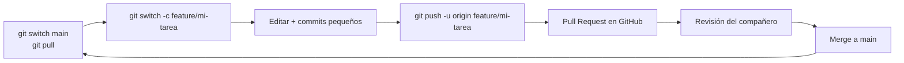

# Cómo colaborar en el proyecto

Guía corta para trabajar en equipo sin pisarnos. Si Git es nuevo para ti, empieza por [`docs/GUIA_GIT.md`](docs/GUIA_GIT.md).

---

## 1. Regla de oro

> **`main` siempre debe funcionar.** Nadie trabaja directamente sobre `main`: cada tarea va en su propia rama y entra por Pull Request.

---

## 2. Flujo de trabajo

1. **Actualiza `main`:** `git switch main` y `git pull`.
2. **Crea tu rama:** `git switch -c feature/nombre-corto`.
3. **Trabaja** y guarda con commits pequeños.
4. **Sube la rama:** `git push -u origin feature/nombre-corto` (las siguientes veces, `git push`).
5. **Abre una Pull Request** en GitHub explicando qué cambiaste y asigna a la otra persona como revisora.
6. **Revisión y merge:** quien revisa prueba el cambio, comenta o aprueba, y se hace *Merge*.
7. **Vuelve a `main`** y haz `git pull`.

---

## 3. Nombres de ramas

| Prefijo | Cuándo | Ejemplo |
|---|---|---|
| `feature/` | Algo nuevo | `feature/estilos-reto-semanal` |
| `fix/` | Corregir un error | `fix/buscador-tildes` |
| `docs/` | Solo documentación | `docs/actualizar-readme` |

Minúsculas, sin tildes ni espacios, palabras separadas por guiones.

---

## 4. Mensajes de commit

En español, en presente y explicando **qué hace** el cambio. Un commit = una idea.

| Bien | Mal |
|---|---|
| `Añade estilos de la tarjeta del reto` | `cambios` |
| `Corrige el buscador con tildes` | `arreglo cosas` |
| `Renombra el logo sin espacios` | `final v2` |

---

## 5. Cómo evitar conflictos

- **Repartimos por archivos.** Antes de tocar uno, se avisa al compañero. Ojo especial con `index.html`, `layout.css` y `components.css`, que son los más compartidos.
- **Pull antes de crear una rama nueva** y, si tu rama dura varios días, vuelve a traer `main` de vez en cuando.
- **Ramas cortas:** cuanto menos viva una rama, menos probabilidades de conflicto.

---

## 6. Convenciones de código

### HTML
- Indentación de **2 espacios**. Atributos con comillas dobles.
- Etiquetas semánticas (`header`, `main`, `section`, `article`, `nav`, `footer`) y un solo `h1` por página.
- Cada `section` con `aria-labelledby` apuntando al id de su título.
- Imágenes siempre con `alt`.
- **La cabecera y el pie se repiten en las 8 páginas:** si cambias uno, cámbialo en todas. En las páginas de `pages/`, el enlace de la sección actual lleva `aria-current="page"`.
- Rutas relativas: `css/...` desde `index.html` y `../css/...` desde `pages/`.

### CSS
- **Colores y fuentes siempre con variables** de `base.css` (`var(--color-primario)`), no con códigos sueltos.
- Cada archivo tiene su papel: `base.css` (variables, reset, tipografía), `layout.css` (estructura y rejillas) y `components.css` (piezas reutilizables).
- Nombres de clases en **español, minúsculas, sin tildes**, con convención tipo BEM: `bloque__elemento` (`perfil-card__avatar`, `reto__etiqueta`).
- Diseño **móvil primero** siempre que se pueda; el punto de corte actual es `800px`.
- Comentario de sección con el estilo que ya usan los archivos.

### JavaScript
- Todo dentro de `DOMContentLoaded`.
- Seleccionar elementos con `getElementById` o `querySelector` y **comprobar que existen** antes de usarlos (las páginas no comparten los mismos elementos).
- Nombres de variables y funciones en español y `camelCase` (`limpiarTexto`, `tarjetasPerfil`).
- Comentar el **porqué**, no lo obvio.

### Archivos y carpetas
- Nombres **sin espacios, sin tildes ni paréntesis**, en minúsculas y con guiones: `logo-uddea.png`.

> **Pendiente de unificar:** `base.css` usa 2 espacios de indentación y `layout.css` y `components.css` usan 3. A partir de ahora, 2 espacios.

---

## 7. Lista de comprobación antes de abrir una Pull Request

- [ ] Abrí la página en el navegador y se ve bien.
- [ ] Probé en ancho de móvil (herramientas del navegador, `F12`).
- [ ] No hay errores en la consola del navegador.
- [ ] Los enlaces y rutas de imágenes funcionan, también desde `pages/`.
- [ ] Si toqué la cabecera o el pie, lo cambié en las 8 páginas.
- [ ] El HTML pasa el [validador del W3C](https://validator.w3.org/).
- [ ] Actualicé la documentación y el [`CHANGELOG.md`](CHANGELOG.md) si el cambio lo requiere.
- [ ] La rama sale de un `main` actualizado.

---

## 8. Si hay un conflicto

Git marca el archivo con `<<<<<<<`, `=======` y `>>>>>>>`. Entre las marcas están las dos versiones: se deja la correcta, se borran las marcas y se hace `git add archivo` y `git commit`. **Si dudas, no borres nada y pregunta.** Más detalle en la sección 8 de [`docs/GUIA_GIT.md`](docs/GUIA_GIT.md).
